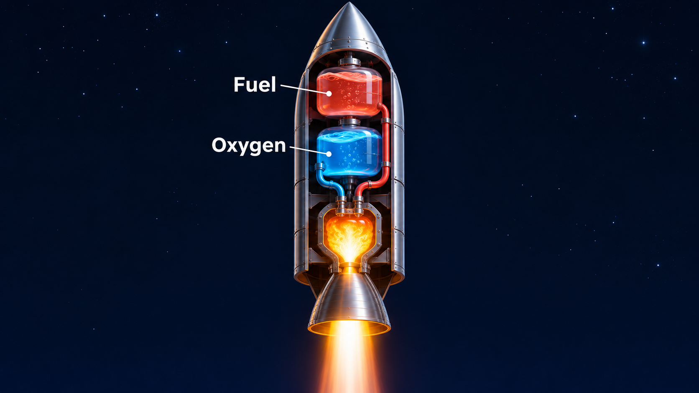
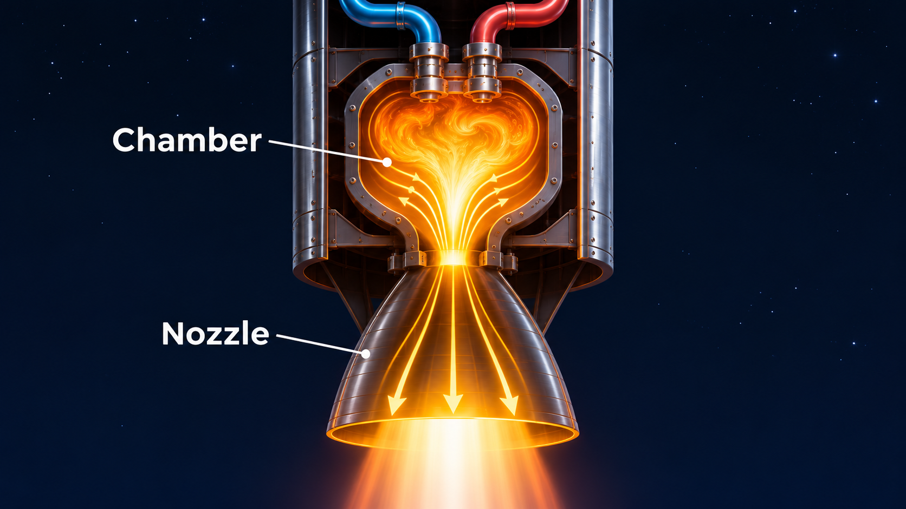
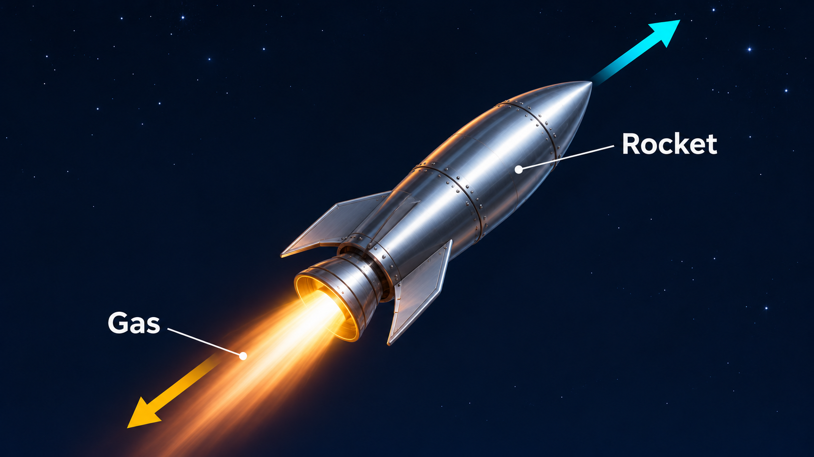
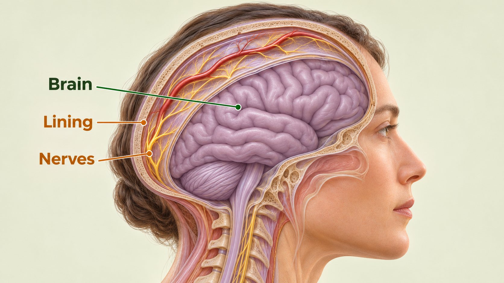
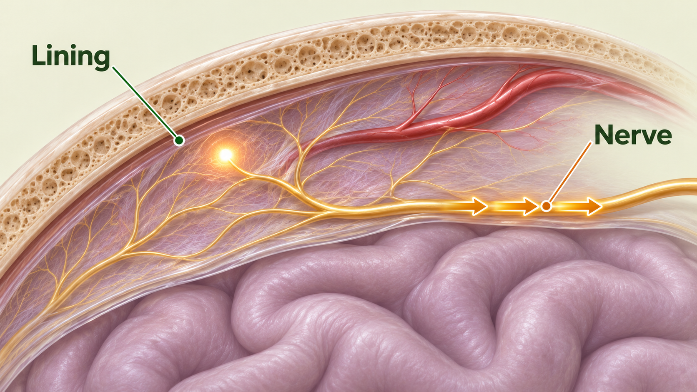
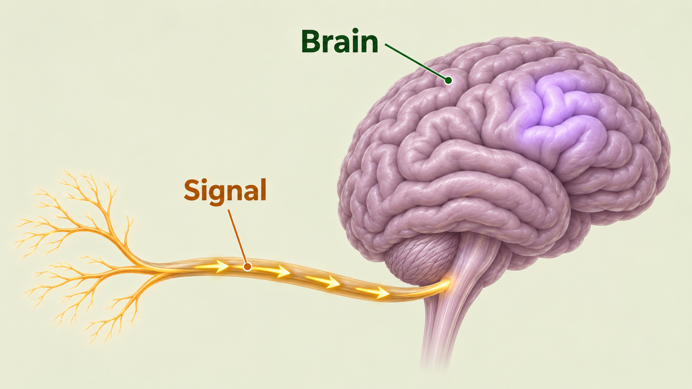
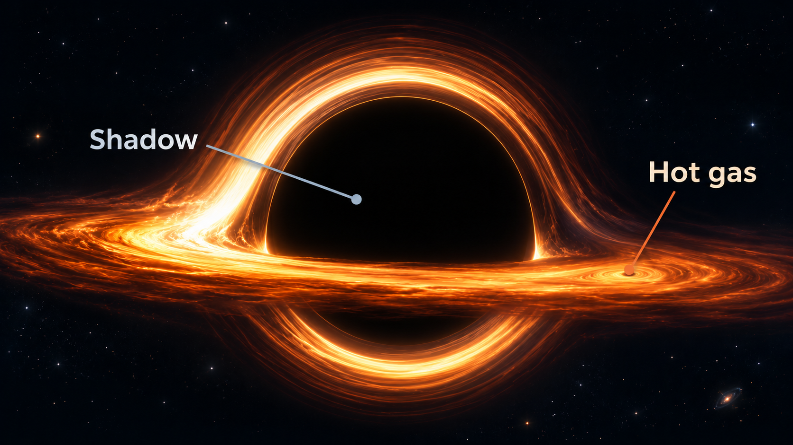
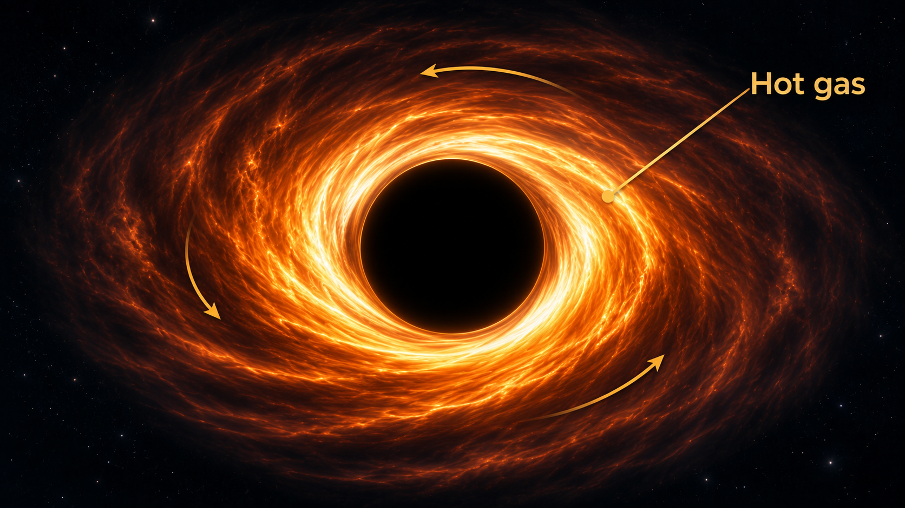
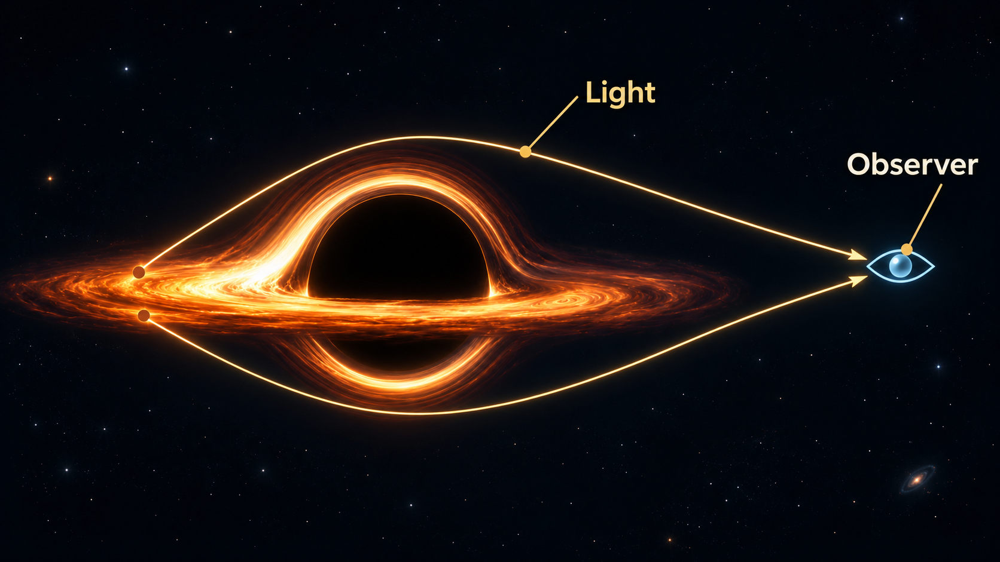

# Hero explanation scripts — three images per topic

Updated 17 November 2026. Each paragraph is spoken over its matching image. The image contains only part labels and useful markings. The 30–31 second silent previews use provisional reading times; final timing will follow the Vertex narration.

## How do rockets work in empty space?

### Image 1: Carry both ingredients

There’s no air in space. But this rocket carries its own fuel and oxygen, so it has both ingredients it needs to burn.

### Image 2: Make gas rush out

The fuel and oxygen meet in this chamber. They burn and make hot gas. The nozzle speeds that gas out of the engine.

### Image 3: Go the other way

As the engine throws gas backward, the gas pushes the rocket forward. It doesn’t need to push against air. That’s how a rocket can fly through empty space.

Scientific reference: [NASA](https://science.nasa.gov/learn/basics-of-space-flight/chapter3-2/).

## If the brain can’t feel pain, why do headaches hurt?

### Image 1: Look around the brain

Your brain helps you feel pain. But brain tissue itself has no pain sensors. The lining and nerves around it are different.

### Image 2: A nerve sends a message

Look closer at the lining. It has pain-sensitive nerve endings. When these nerves are activated, they send a message toward the brain.

### Image 3: The brain processes it

The message reaches your brain, which processes it as pain. That’s why a headache can feel deep inside your head, even when the signal started in nearby tissue. Different headaches have different causes.

Scientific reference: [NIH](https://newsinhealth.nih.gov/2014/03/headache-pain).

## Why is there a bright ring around a black hole?

### Image 1: The light comes from outside

A black hole traps light. So why is this one surrounded by a bright ring? We’re seeing glowing gas outside it, around a dark shadow.

### Image 2: The gas forms a hot disk

From above, the gas forms a flat, swirling disk. As it moves inward, it heats up and glows. The gas gives us the light we can see.

### Image 3: Gravity bends the view

Now follow the light. Gravity bends its path around the black hole. Light from the far side can reach our eyes, making the disk appear to curve above and below the shadow.

Scientific reference: [NASA](https://science.nasa.gov/universe/black-holes/anatomy/).

## Voice direction for the next stage

Warm, natural adult female voice, speaking to one curious person. Clear everyday English, a gentle lift on the opening question, natural connected phrasing and brief pauses. Target roughly 155–165 words per minute; avoid a sales-announcer voice. Use Gemini on Vertex, with one consistent voice across all three topics. Audio has not been generated in this revision.
